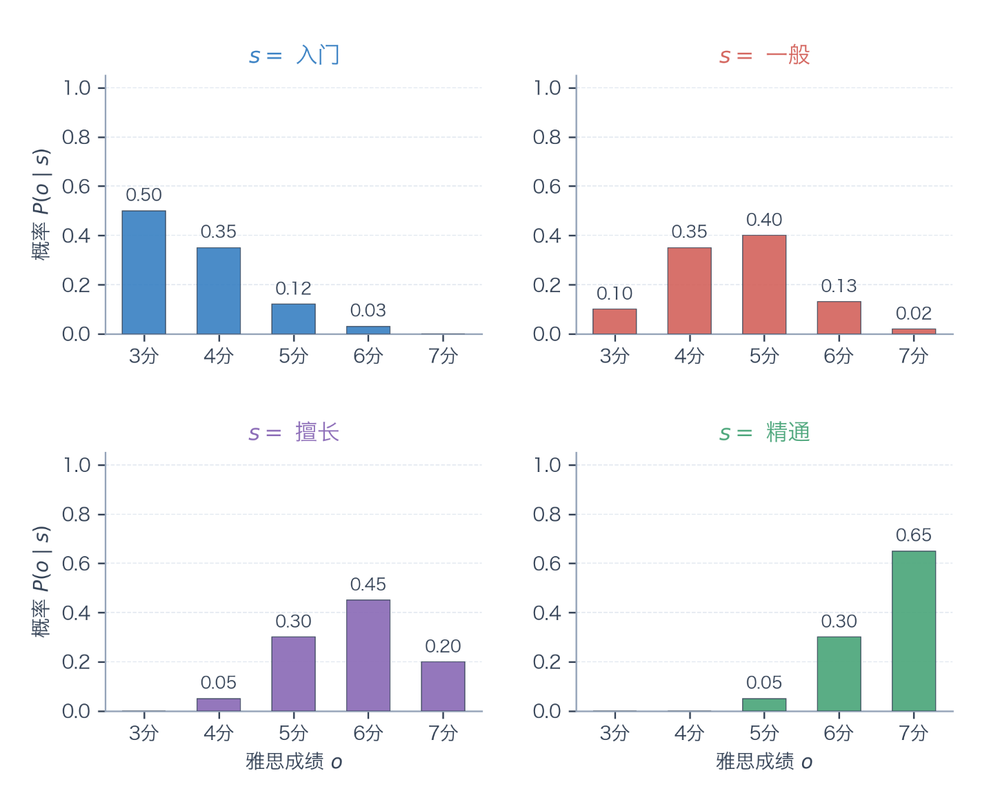
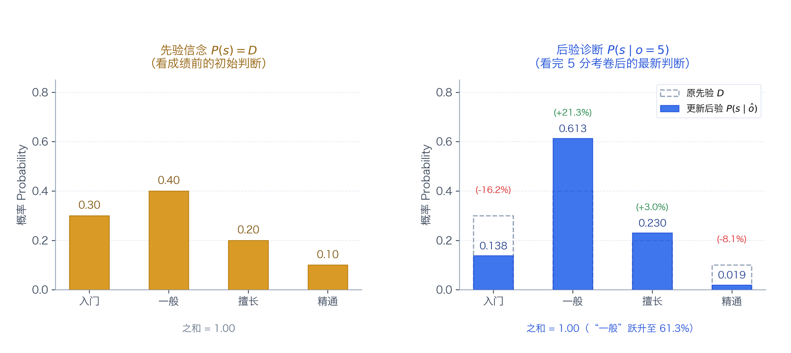

## 写在前面

在学习自由能原则的过程中，我经常被 Friston 大量的数学符号（$A, B, C, D, E, P, Q, F, G, \gamma$）绕晕[^friston2010] [^friston2015epistemic] [^friston2017process]，往往一个实例理解了一部分内容，却在下一个情境下失效，甚至符号所指代的概念也会变来变去。无论是在 Friston 的论文中，还是在 2022 年的教材[^parr2022]里，又或是 `pymdp` 库里的实例，常规使用的老鼠迷宫 T-Maze 案例，令我感觉单薄，感知与行动在毫秒间计算纠缠，缺乏丰富的把玩空间。

昨天周四，第一次知道了今年 Namjoshi 新出版的《Fundamentals of Active Inference》[^namjoshi2026]，更为详细地解释了推导过程，要比 2022年 《Active Inference》[^parr2022]友好的多，但作者使用的实例，依旧是常见的天气推断以及网格世界这样的例子，读起来虽然顺畅太多，符号多起来依旧让人头大。

而本文将以技能测量与教学干预为例，拆解离散主动推理的完整数学架构。所谓技能测量，可以认为是托福雅思这样的标准化考试，而测量结果自然是考生的成绩，我们想知道的隐藏态，也便是考生自身的语言能力水平，教学干预就是辅导老师对学习计划的制定。

本文将以雅思考试为主要例子，同时以更为普遍熟知的高考备考为辅，来拆解主动推理在POMDP下的各种符号和公式的含义。

本文有助于理解《Fundamentals of Active Inference》一书中第九章和第十章的内容，以及 《Active Inference》 中第七章和附录B的内容。但本文中如果说“书中”，特指今年新出版的《Fundamentals of Active Inference》这本书。另外，本文是我真正想写的《游戏为什么好玩？》的前置知识文章。

## 静态推理

我们假设，现在智能体（agent）是一个辅导雅思的老师，他要面对一个想出国留学的大学生（environment），这个学生每周都会参加一次雅思考试（observation），给老师提供一个雅思成绩（$o$），但作为这个老师，每周只能和学生交流十分钟（action / policy）。

这里的老师对于学生英语能力（hidden states，$s$）的判断就是一个生成模型（generative model），而学生作为环境是一个生成过程（generative process）。

在引入动态推演（$B$）和教学干预（$\pi$）之前，我们先看最简化的**静态场景**，第一次见面时，辅导老师和新来的备考雅思的大学生头一次交流。

对于学生的知识掌握度和雅思分数，我们用分类分布（Categorical Distribution）来描述。对任意离散随机变量 $x$，分类分布记作 $\mathrm{Cat}(x; \boldsymbol{p})$，其中概率向量 $\boldsymbol{p}$ 的每个元素都在 $[0, 1]$ 之间，且总和必须为 $1$。

## 隐藏态先验 $\boldsymbol{D}$

假设老师脑中将学生的真实雅思掌握程度（隐藏态 $\boldsymbol{s}$）划分为 $N_s = 4$ 个离散等级：**入门、一般、擅长、精通**。在还没看任何成绩之前，老师对学生初始水平的先验信念定义为（对应原书 **式 9.1**）：

$$P_D(\boldsymbol{s}) \triangleq \mathrm{Cat}(\boldsymbol{s}; \boldsymbol{D}) \tag{9.1}$$

其中参数向量 $\boldsymbol{D} \in [0, 1]^4$ 是一个 $4$ 维列向量，满足每个元素 $\in [0, 1]$ 且元素之和为 $1$。结合新接手普通备考生的经验，老师给出如下初始估计（对应原书 **式 9.2**）：

$$P_D(\boldsymbol{s}) = \mathrm{Cat}(\boldsymbol{D}) = \begin{bmatrix} \text{入门} & \text{一般} & \text{擅长} & \text{精通} \\ 0.30 & 0.40 & 0.20 & 0.10 \end{bmatrix}^\top \tag{9.2}$$

这表示在没有任何交流和测试前，老师认为这位新同学在准备雅思考试这件事上，有 30% 概率处于“入门”、40% 处于“一般”、20% 处于“擅长”，仅有 10% 概率一来就已经“精通”。因为老师常见接触的是在雅思需要额外助力的大学生，所以这里的英语水平评价是在这位老师看来某位学生在备考雅思学生人群中的技能水平评价，也是为了制定学习策略的核心隐变量。

用 Python 来表示，就是：

```python
import numpy as np
states = ["入门", "一般", "擅长", "精通"]
D = np.array([0.30, 0.40, 0.20, 0.10])
```

而从 Cat(D) 中抽样相当于掷一颗 4 面不均匀骰子，决定学生开学初的真实水平，也就是：

```python
s = np.random.choice(len(states), p=D)
```

## 似然矩阵 $\boldsymbol{A}$

老师无法直接打开学生的脑子看到 $\boldsymbol{s}$，只能看到考卷上打出来的雅思分数，我们这里简化只取 $N_o = 5$ 个离散观测结果 $\boldsymbol{o} \in \{3, 4, 5, 6, 7\}$。

为了更好的理解，可以近似地认为，雅思 3 分，相当于高考英语及格线左右；雅思 4 分，相当于高考 110–120分；5分相当于过了大学四级；6分相当于过了大学六级；而一般英国名校的常见门槛是 $7$，相当于托福 $100$ 分左右。

为了描述“不同真实水平的学生，各自有多大概率考出几分”，我们定义条件分类分布，即**似然矩阵**（对应 **式 9.3**）：

$$P_A(\boldsymbol{o} \mid \boldsymbol{s}) \triangleq \mathrm{Cat}(\boldsymbol{o}; \boldsymbol{A}) \tag{9.3}$$

这里的参数 $\boldsymbol{A} \in [0, 1]^{5 \times 4}$ 是一个 **$5$ 行 $4$ 列的概率矩阵**：
* 列对应 4 种隐藏态 $\boldsymbol{s}$（入门、一般、擅长、精通）；
* 行对应 5 种考试成绩 $\boldsymbol{o}$（3分、4分、5分、6分、7分）；
* 每一列都是一个独立的分类分布，因此每一列之和必须为 1。

一个贴合真实雅思考试区分度的 $\boldsymbol{A}$ 矩阵可以写成（对应 **式 9.4**）：

$$P_A(\boldsymbol{o} \mid \boldsymbol{s}) = \mathrm{Cat}(\boldsymbol{A}) = \begin{array}{c} \text{3分} \\ \text{4分} \\ \text{5分} \\ \text{6分} \\ \text{7分} \end{array} \overset{\begin{matrix}\text{入门} & \;\text{一般} & \;\text{擅长} & \;\text{精通}\end{matrix}}{\begin{bmatrix} 0.50 & 0.10 & 0.00 & 0.00 \\ 0.35 & 0.35 & 0.05 & 0.00 \\ 0.12 & 0.40 & 0.30 & 0.05 \\ 0.03 & 0.13 & 0.45 & 0.30 \\ 0.00 & 0.02 & 0.20 & 0.65 \end{bmatrix}} \tag{9.4}$$

如果我们提取 $P_A(\boldsymbol{o} \mid \boldsymbol{s} = \text{擅长})$，也就是 $\boldsymbol{A}$ 的**第 3 列** $[0.00,\; 0.05,\; 0.30,\; 0.45,\; 0.20]^\top$，根据这个向量，老师认为如果一个学生真实英语水平是“擅长”，他大概率考 6 分（45%）或 5 分（30%），超常发挥能冲 7 分（20%），失常偶尔掉到 4 分（5%），几乎不可能考 3 分（0%）。用 Python 表示就是：

```python
A = np.array([
    [0.50, 0.10, 0.00, 0.00],  # 3分
    [0.35, 0.35, 0.05, 0.00],  # 4分
    [0.12, 0.40, 0.30, 0.05],  # 5分
    [0.03, 0.13, 0.45, 0.30],  # 6分
    [0.00, 0.02, 0.20, 0.65],  # 7分
])

s_good = np.array([0, 0, 1, 0])   # s = 擅长
p_o_given_good = A @ s_good # 用 one-hot 向量做矩阵乘法
```

<figure>
  
  <figcaption>上期学习水平对的概率分布</figcaption>
</figure>

似然矩阵 $A$ 可以看作是对雅思考试的区分度与信度模型，通过上图我们看出雅思考试还是很有区分度的，虽然并不是每次考试都能极为精准地测量学生的真实水平，但这种环境的噪音正是部分可观测（Partially Observable）的来源，而不像 AlphaGo 那样整个游戏没有迷雾。

## 生成模型 $\mathcal{M}$

在主动推理中，仅靠上面的两个分布，就组成了生成模型（Generative Model）：

* **似然矩阵** $\mathrm{Cat}(\boldsymbol{A}) = P_A(\boldsymbol{o} \mid \boldsymbol{s})$：描述老师相信“真实水平 $\boldsymbol{s}$ 如何产出考卷分数 $\boldsymbol{o}$”；
* **隐藏态先验** $\mathrm{Cat}(\boldsymbol{D}) = P_D(\boldsymbol{s})$：描述老师在看到任何考试成绩前对“学生底子 $\boldsymbol{s}$”的初始判断。

将两者合在一起，老师脑中的静态生成模型写作（对应原书 **式 9.5**）：

$$\mathcal{M} \triangleq \begin{cases} P_A(\boldsymbol{o} \mid \boldsymbol{s}) = \mathrm{Cat}(\boldsymbol{A}) & \text{似然矩阵（考试信度）} \\ P_D(\boldsymbol{s}) = \mathrm{Cat}(\boldsymbol{D}) & \text{隐藏态先验（交流前估计）} \end{cases} \tag{9.5}$$

省去参数下标后，这个生成模型等价于隐藏态与观测成绩的**联合概率分布**（对应原书 **式 9.6**）：

$$P(\boldsymbol{s}, \boldsymbol{o}) = P(\boldsymbol{o} \mid \boldsymbol{s}) P(\boldsymbol{s}) \tag{9.6}$$

至此，只要给定 $\boldsymbol{D}$ 和 $\boldsymbol{A}$，老师就能**正向生成**对考卷分数的预测。

而接下来（9.1.2 节）要做的事，则是把这个模型**求逆（Inversion）**，当学生拿出雅思 **5 分** 的成绩单（观测向量 $\hat{\boldsymbol{o}} = [0, 0, 1, 0, 0]^\top$）时，用贝叶斯定理反推出学生脑中真实的水平后验 $P(\boldsymbol{s} \mid \hat{\boldsymbol{o}})$。

## 后验 $P(\boldsymbol{s} \mid \boldsymbol{o})$

现在学生坐下来，第一次和老师交流，告诉老师上一次雅思考试，考了 5 分，老师要根据看到的雅思分数 $\boldsymbol{o}$，反推学生脑中真实的掌握程度 $\boldsymbol{s}$。

因为毕竟不是一无所知了，不能继续使用先验那个概率分布，比如说，现在我们知道这个学生精通英语的概率就很低了，否则不能仅仅打了五分，40道雅思阅读题，就算错了24道，也能打五分。但是精通的概率降低了多少呢？

在现在这种简单的静态场景里，我们不需要近似，直接用**贝叶斯定理**就能精确算出后验分布（对应原书 **式 9.7**）：

$$P(\boldsymbol{s} \mid \boldsymbol{o}) = \frac{P(\boldsymbol{o} \mid \boldsymbol{s}) P(\boldsymbol{s})}{P(\boldsymbol{o})} \tag{9.7}$$

我们定义一个 $5$ 维观测向量 $\hat{\boldsymbol{o}} \in \{0, 1\}^5$（$\hat{\cdot}$ 表示该观测在现实中确定发生）：

$$\hat{\boldsymbol{o}} = \begin{bmatrix} \text{3分} & \text{4分} & \text{5分} & \text{6分} & \text{7分} \\ 0 & 0 & 1 & 0 & 0 \end{bmatrix}^\top \tag{9.8}$$

假设学生分别是入门、一般、擅长、精通，各自有多大概率考出 5 分？等价于从考试信度矩阵 $\boldsymbol{A}$ 中，直接抽出“5 分”对应的**第 3 行**。也就是：

$$P(\boldsymbol{o} = \hat{\boldsymbol{o}} \mid \boldsymbol{s}) = \boldsymbol{A}^\top \hat{\boldsymbol{o}} \tag{9.9}$$

代入 9.1.1 节的 $\boldsymbol{A}$ 矩阵：

$$\underbrace{\begin{bmatrix} 0.50 & 0.10 & 0.00 & 0.00 \\ 0.35 & 0.35 & 0.05 & 0.00 \\ \mathbf{0.12} & \mathbf{0.40} & \mathbf{0.30} & \mathbf{0.05} \\ 0.03 & 0.13 & 0.45 & 0.30 \\ 0.00 & 0.02 & 0.20 & 0.65 \end{bmatrix}^\top}_{\boldsymbol{A}^\top} \underbrace{\begin{bmatrix} 0 \\ 0 \\ 1 \\ 0 \\ 0 \end{bmatrix}}_{\hat{\boldsymbol{o}}} = \begin{bmatrix} 0.12 \\ 0.40 \\ 0.30 \\ 0.05 \end{bmatrix} \begin{array}{l} \leftarrow \text{入门} \\ \leftarrow \text{一般} \\ \leftarrow \text{擅长} \\ \leftarrow \text{精通} \end{array} \tag{9.10}$$

这个似然向量的元素之和是 $0.12 + 0.40 + 0.30 + 0.05 = 0.87 \neq 1$！这也很好理解，比如把考卷换成中文测试，不管学生英文是入门还是精通，考低分（3 分）的概率都很低，四个数加起来可能接近于 0；反过来考高分（7 分）的概率都很高，四个数加起来甚至能接近 4。所以横向“一行”只是似然打分，根本不要求加起来等于 1。

将上一步得到的似然向量 $\boldsymbol{A}^\top \hat{\boldsymbol{o}}$ 与最初的先验向量 $\boldsymbol{D}$ 逐元素相乘（Hadamard 积 $\odot$），得到未归一化的联合概率（对应原书 **式 9.11**）：

$$P(\boldsymbol{s} \mid \hat{\boldsymbol{o}}) \propto (\boldsymbol{A}^\top \hat{\boldsymbol{o}}) \odot \boldsymbol{D} = \begin{bmatrix} 0.12 \\ 0.40 \\ 0.30 \\ 0.05 \end{bmatrix} \odot \begin{bmatrix} 0.30 \\ 0.40 \\ 0.20 \\ 0.10 \end{bmatrix} = \begin{bmatrix} 0.036 \\ 0.160 \\ 0.060 \\ 0.005 \end{bmatrix} \tag{9.11}$$

将这 4 个数加起来，就得到贝叶斯分母，也就是**边缘似然**，或者叫做模型证据：
$$P(\boldsymbol{o} = \text{5分}) = 0.036 + 0.160 + 0.060 + 0.005 = \mathbf{0.261}$$

用它做归一化，即得精确贝叶斯后验的矩阵形式（对应原书 **式 9.12**）：

$$P(\boldsymbol{s} \mid \hat{\boldsymbol{o}}) = \frac{(\boldsymbol{A}^\top \hat{\boldsymbol{o}}) \odot \boldsymbol{D}}{\sum_s (\boldsymbol{A}^\top \hat{\boldsymbol{o}}) \odot \boldsymbol{D}} = \frac{1}{0.261} \begin{bmatrix} 0.036 \\ 0.160 \\ 0.060 \\ 0.005 \end{bmatrix} \approx \begin{bmatrix} 0.138 \\ 0.613 \\ 0.230 \\ 0.019 \end{bmatrix} \tag{9.12}$$

<figure>
  
  <figcaption>在得知学生雅思成绩为 5 之后的隐变量概率分布</figcaption>
</figure>

上图中形象地看出，知道成绩后，老师对学生能力评价的概率分布的转移，就是向英语水平处于“一般” 收束，而入门和精通的概率都骤降。

在主动推理中，为了避免连乘下溢，把概率相乘变成对数相加（只是应用了$x = e^{\ln x}$ 这个性质），教材会把式（9.12）改写为等价的 **Softmax 形式**（对应原书 **式 9.13**）：                            

$$P(\boldsymbol{s} \mid \hat{\boldsymbol{o}}) = \frac{e^{\ln \boldsymbol{A}^\top \hat{\boldsymbol{o}} + \ln \boldsymbol{D}}}{\sum_s e^{\ln \boldsymbol{A}^\top \hat{\boldsymbol{o}} + \ln \boldsymbol{D}}} = \sigma\big( \ln \boldsymbol{A}^\top \hat{\boldsymbol{o}} + \ln \boldsymbol{D} \big) \tag{9.13}$$

这个公式作为静态时对隐藏态分布的计算，在后面的更新算法中，会反复出现类似的形式，也就是有很多对数相加（每个相关方的投票），来算出最终的分布。

上面的计算用 Python 表示，就是：

```python
from scipy.special import softmax

# 收到 5 分雅思成绩（one-hot 向量）这个信息
o_hat = np.array([0, 0, 1, 0, 0])

# 写法 1：式 (9.12) 直接矩阵乘法 + 归一化
lik = A.T @ o_hat                      # [0.12, 0.40, 0.30, 0.05]
post_direct = (lik * D) / np.sum(lik * D)

# 写法 2：式 (9.13) 对数空间 + Softmax
logits = np.log(lik) + np.log(D)
post_softmax = softmax(logits)
```

以上做的是利用极为简化的情景，做基础的精准贝叶斯运算，接下来，我们将引入动态环境，随后再引入行为干预。

<!-- ================= Textbooks & Tutorials ================= -->
[^namjoshi2026]: Namjoshi, S. V. (2026). *Fundamentals of Active Inference: Principles, Algorithms, and Applications of the Free Energy Principle for Engineers*. The MIT Press.
[^parr2022]: Parr, T., Pezzulo, G., & Friston, K. J. (2022). *Active Inference: The Free Energy Principle in Mind, Brain, and Behavior*. The MIT Press.
[^smith2022]: Smith, R., Friston, K. J., & Whyte, C. J. (2022). A step-by-step tutorial on active inference and its application to empirical data. *Journal of Mathematical Psychology*, 107, 102632.
[^bogacz2017]: Bogacz, R. (2017). A tutorial on the free-energy framework for modelling perception and learning. *Journal of Mathematical Psychology*, 76, 198–211. https://doi.org/10.1016/j.jmp.2015.11.003
[^buckley2017]: Buckley, C. L., Kim, C. S., McGregor, S., & Seth, A. K. (2017). The free energy principle for action and perception: A mathematical review. *Journal of Mathematical Psychology*, 81, 55–79.

<!-- ================= FEP Foundations & Physics ================= -->
[^friston2006]: Friston, K., Kilner, J., & Harrison, L. (2006). A free energy principle for the brain. *Journal of Physiology-Paris*, 100(1–3), 70–87.
[^friston2010]: Friston, K. (2010). The free-energy principle: A unified brain theory? *Nature Reviews Neuroscience*, 11(2), 127–138. https://doi.org/10.1038/nrn2787
[^hohwy2016]: Hohwy, J. (2016). The self-evidencing brain. *Noûs*, 50(2), 259–285.
[^ramstead2018]: Ramstead, M. J. D., Badcock, P. B., & Friston, K. J. (2018). Answering Schrödinger's question: A free-energy formulation. *Physics of Life Reviews*, 24, 1–16. https://doi.org/10.1016/j.plrev.2017.09.001
[^friston2019physics]: Friston, K. (2019). A free energy principle for a particular physics. *arXiv preprint* arXiv:1906.10184.
[^friston2021obs]: Friston, K. J., Da Costa, L., & Parr, T. (2021). Some interesting observations on the free energy principle. *Entropy*, 23(8), 1076.
[^fields2022]: Fields, C., Friston, K., Glazebrook, J. F., & Levin, M. (2022). A free energy principle for generic quantum systems. *Progress in Biophysics and Molecular Biology*, 173, 36–59.
[^friston2023simple]: Friston, K., Da Costa, L., Sajid, N., Heins, C., Ueltzhöffer, K., Pavliotis, G. A., & Parr, T. (2023). The free energy principle made simpler but not too simple. *Physics Reports*, 1024, 1–29. https://doi.org/10.1016/j.physrep.2023.07.001

<!-- ================= Discrete Active Inference (POMDP) ================= -->
[^friston2009rl]: Friston, K. J., Daunizeau, J., & Kiebel, S. J. (2009). Reinforcement learning or active inference? *PLoS ONE*, 4(7), e6421.
[^friston2015epistemic]: Friston, K., Rigoli, F., Ognibene, D., Mathys, C., FitzGerald, T., & Pezzulo, G. (2015). Active inference and epistemic value. *Cognitive Neuroscience*, 6(4), 187–214. https://doi.org/10.1080/17588928.2015.1020053
[^fitzgerald2015urn]: FitzGerald, T. H. B., Schwartenbeck, P., Moutoussis, M., Dolan, R. J., & Friston, K. (2015). Active inference, evidence accumulation, and the urn task. *Neural Computation*, 27(2), 306–328.
[^friston2017process]: Friston, K., FitzGerald, T., Rigoli, F., Schwartenbeck, P., & Pezzulo, G. (2017). Active inference: A process theory. *Neural Computation*, 29(1), 1–49.
[^friston2017temporal]: Friston, K. J., Rosch, R., Parr, T., Price, C., & Bowman, H. (2017). Deep temporal models and active inference. *Neuroscience & Biobehavioral Reviews*, 77, 388–402. https://doi.org/10.1016/j.neubiorev.2017.04.009
[^friston2017curiosity]: Friston, K. J., Lin, M., Frith, C. D., Pezzulo, G., Hobson, J. A., & Ondobaka, S. (2017). Active inference, curiosity and insight. *Neural Computation*, 29(10), 2633–2683.
[^friston2023structure]: Friston, K. J., Da Costa, L., Tschantz, A., Kiefer, A., Salvatori, T., Neacsu, V., Koudahl, M., Heins, C., Sajid, N., Markovic, D., Parr, T., Verbelen, T., & Buckley, C. L. (2023). Supervised structure learning. *arXiv preprint*.

<!-- ================= Predictive Coding, Precision, Valence & Games ================= -->
[^rao1999]: Rao, R. P. N., & Ballard, D. H. (1999). Predictive coding in the visual cortex: A functional interpretation of some extra-classical receptive-field effects. *Nature Neuroscience*, 2(1), 79–87.
[^feldman2010]: Feldman, H., & Friston, K. J. (2010). Attention, uncertainty, and free-energy. *Frontiers in Human Neuroscience*, 4, 215. https://doi.org/10.3389/fnhum.2010.00215
[^joffily2013]: Joffily, M., & Coricelli, G. (2013). Emotional valence and the free-energy principle. *PLoS Computational Biology*, 9(6), e1003094.
[^brielmann2022]: Brielmann, A. A., & Dayan, P. (2022). A computational model of aesthetic value. *Psychological Review*, 129(6), 1319–1337.
[^deterding2022]: Deterding, S., Andersen, M. M., Kiverstein, J., & Miller, M. (2022). Mastering uncertainty: A predictive processing account of enjoying uncertain success in video game play. *Frontiers in Psychology*, 13, 924953. https://doi.org/10.3389/fpsyg.2022.924953

<!-- ================= Math, Physics & ML Foundations ================= -->
[^jaynes1957]: Jaynes, E. T. (1957). Information theory and statistical mechanics. *Physical Review*, 106(4), 620–630.
[^feynman1972]: Feynman, R. P. (1972). *Statistical Mechanics: A Set of Lectures*. W. A. Benjamin.
[^crauel1994]: Crauel, H., & Flandoli, F. (1994). Attractors for random dynamical systems. *Probability Theory and Related Fields*, 100(3), 365–393.
[^dayan2001]: Dayan, P., & Abbott, L. F. (2001). *Theoretical Neuroscience: Computational and Mathematical Modeling of Neural Systems*. The MIT Press.
[^liberzon2012]: Liberzon, D. (2012). *Calculus of Variations and Optimal Control Theory: A Concise Introduction*. Princeton University Press.
[^ramsauer2021]: Ramsauer, H., Schäfl, B., Lehner, J., et al. (2021). Hopfield networks is all you need. *ICLR 2021* (arXiv:2008.02217).
[^murphy2022]: Murphy, K. P. (2022). *Probabilistic Machine Learning: An Introduction*. The MIT Press.
[^murphy2023]: Murphy, K. P. (2023). *Probabilistic Machine Learning: Advanced Topics*. The MIT Press.

<!-- ================= Essential External Classics ================= -->
[^friston2005]: Friston, K. (2005). A theory of cortical responses. *Philosophical Transactions of the Royal Society B: Biological Sciences*, 360(1456), 815–836.
[^clark2013]: Clark, A. (2013). Whatever next? Predictive brains, situated agents, and the future of cognitive science. *Behavioral and Brain Sciences*, 36(3), 181–204.
[^dacosta2020]: Da Costa, L., Parr, T., Sajid, N., Veselic, S., Neacsu, V., & Friston, K. (2020). Active inference on discrete state-spaces: A synthesis. *Journal of Mathematical Psychology*, 99, 102447.
[^heins2022pymdp]: Heins, C., Millidge, B., Demekas, D., Klein, B., Friston, K., Couzin, I. D., & Tschantz, A. (2022). `pymdp`: A Python library for active inference in discrete state spaces. *Journal of Open Source Software*, 7(73), 4098.