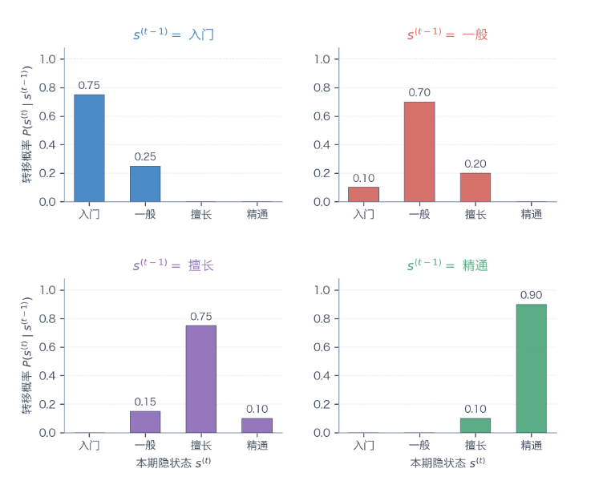
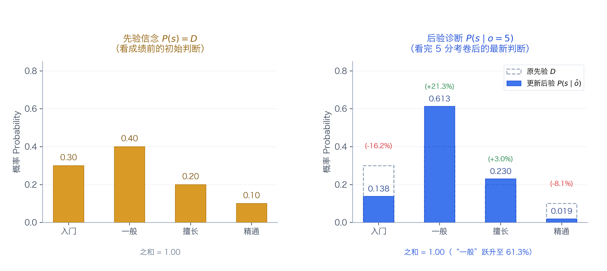
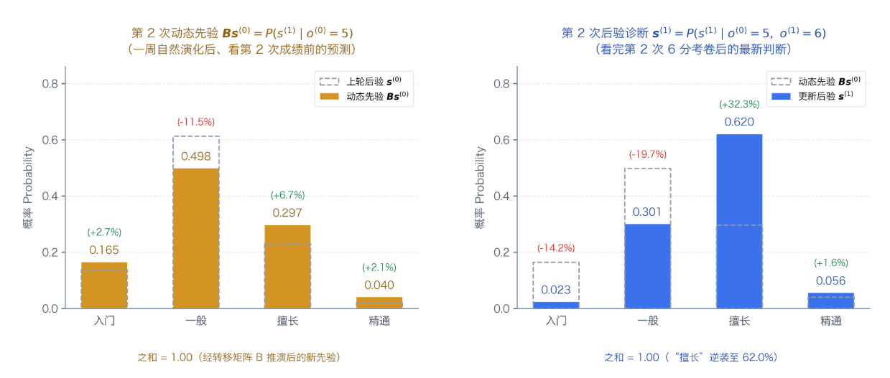
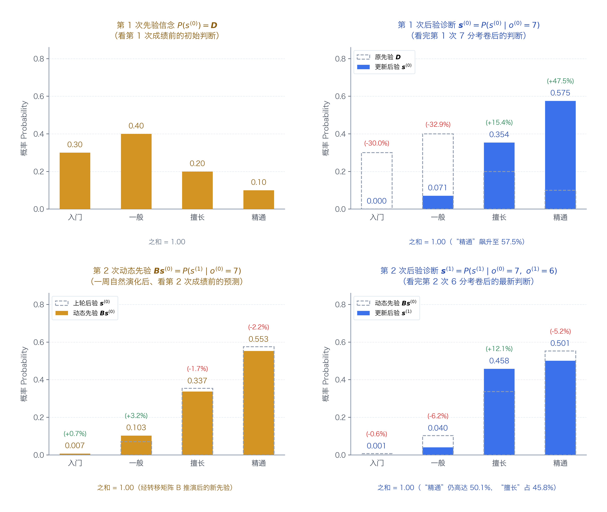

书接上回，2026年的这个教材在9.2节开端有很多不谨慎的错误，我在这里一并展开和解释。为了减少误解和歧义，我们先从三次考试成绩说起。

## 状态转移矩阵 $B$

我们之前说，学生第一次来的时候，说自己上一次雅思考了五分，第一次交流之后，辅导老师认为学生的雅思水平的概率分布是 ：

$$P(\boldsymbol{s} \mid \hat{\boldsymbol{o}}) \approx \begin{bmatrix} 0.138 \\ 0.613 \\ 0.230 \\ 0.019 \end{bmatrix} $$

老师没有给学生任何建议，但老师对于学生周之后的学习能力，已经有了一个预估，也就是根据现在的学习水平，估算下一次见面时候的学习水平，而计算这个估算的矩阵，就是 $B$。

假设学生纯靠自学备考，一周内大概率原地踏步，有小概率靠刷题上一个台阶，也有小概率松懈退回一档。状态转移矩阵 $\boldsymbol{B}$ 可以写成：

$$P_B(\boldsymbol{s}^{(t)} \mid \boldsymbol{s}^{(t-1)}) = \mathrm{Cat}(\boldsymbol{B}) = \begin{array}{c} \text{入门} \\ \text{一般} \\ \text{擅长} \\ \text{精通} \end{array} \overset{\begin{matrix}\text{入门} & \;\text{一般} & \;\text{擅长} & \;\text{精通}\end{matrix}}{\begin{bmatrix} 0.75 & 0.10 & 0.00 & 0.00 \\ 0.25 & 0.70 & 0.15 & 0.00 \\ 0.00 & 0.20 & 0.75 & 0.10 \\ 0.00 & 0.00 & 0.10 & 0.90 \end{bmatrix}}$$

例如看第 2 列（上期“一般”）：周后有 70% 概率维持在“一般”，20% 概率发力自学进阶到“擅长”，10% 概率因为没有学习而滑回“入门”。

<figure>
  
  <figcaption>一周前学习水平预测当下学习水平的概率分布</figcaption>
</figure>

上图可以看出，如果根据一周前的学习水平，在没有任何干预的情况下如何预测当下的学习水平，可以看到大多数情况下，学习水平都处于原来的段位，毕竟一周之内不容易有波动。对于 $B$，和 $A$ 类似：

* **列** 代表 **上一期**的隐状态 $\boldsymbol{s}^{(t-1)}$，**行**代表**本期**的隐状态 $\boldsymbol{s}^{(t)}$
* **每一列之和必须严格等于 $1$**

## 第二次见面，知道成绩之前

为了让上面的角标更明确，我们重新捋顺，我们刚才提到的 $P(\boldsymbol{s} \mid \hat{\boldsymbol{o}})$，其实就是我们知道了第一次雅思是6分之后对隐状态的概率分布估计，也可以写成：

$$
P\big(s^{(0)} \mid o^{(0)} = 5\text{分}\big)
$$

<figure>
  
  <figcaption>在得知学生雅思成绩为 5 之后的隐变量概率分布</figcaption>
</figure>

上角标 0 就是第一次见面交流的意思，我们对隐状态的概率分布从先验 $P(s^{(0)})$ （上图左）变成了 $ P\big(s^{(0)} \mid o^{(0)} = 5\text{分}\big)$ 这个后验（上图右）。

现在一周过去，迎来第 2 次见面（$t=1$），我们在知道这周成绩之前，隐状态的概率分布是：

$$
P\big(s^{(1)} \mid o^{(0)} = 5\text{分}\big)
$$

为了求解上式，我们需要展开：

$$P\big(s^{(1)} \mid o^{(0)} = 5\text{分}\big) = \sum_{s^{(0)}} P\big(s^{(1)} \mid s^{(0)},\,  o^{(0)} = 5\text{分}\big)\cdot \underbrace{P\big(s^{(0)} \mid o^{(0)} = 5\text{分}\big)}_{\text{上次后验 } \boldsymbol{s}^{(0)}}$$

因为我们现在是使用的隐马尔可夫模型，所以 $P\big(s^{(1)} \mid s^{(0)},\,  o^{(0)} = 5\text{分}\big)$ 就是  $P\big(s^{(1)} \mid s^{(0)}\big)$ ，任何时刻的隐状态，只依赖于前一刻的隐状态。也就是说，成绩只是观测结果，不会直接反作用于学生水平，所以在给定了 前一刻的隐状态后，其他的信息（$o^{(0)} = 5\text{分}$）就是冗余的了。

也就是说：

$$P\big(s^{(1)} \mid o^{(0)} = 5\text{分}\big) = \sum_{s^{(0)}} \underbrace{P\big(s^{(1)} \mid s^{(0)}\big)}_{\text{转移矩阵 } \boldsymbol{B}} \cdot \underbrace{P\big(s^{(0)} \mid o^{(0)} = 5\text{分}\big)}_{\text{上次后验 } \boldsymbol{s}^{(0)}}$$

我们展开一个情景，比如说，我们想知道，现在过了一周，我们对学生能力的判断是变成了 “入门”，那么这个概率怎么求？

$$\begin{aligned}
P(s^{(1)}=\text{入门} \mid o^{(0)}=5\text{分})
&= P(\text{这次入门}\mid\text{上次入门})\cdot P(\text{上次入门}\mid\text{上次5分}) \\& \,\,+  P(\text{这次入门}\mid\text{上次一般})\cdot P(\text{上次一般}\mid\text{上次5分}) \\& \,\,+ P(\text{这次入门}\mid\text{上次擅长})\cdot P(\text{上次擅长}\mid\text{上次5分})  \\& \,\,+ P(\text{这次入门}\mid\text{上次精通})\cdot P(\text{上次精通}\mid\text{上次5分})  \\
&= 0.75 \times 0.138 \\& \,\,+ 0.10 \times 0.613 \\& \,\,+ 0 \times 0.230 \\& \,\,+ 0 \times 0.019 \\
&= 0.1035 + 0.0613 \approx \mathbf{0.165}
\end{aligned}$$

对于所有四种情景可能，具体的运算如下：

$$
\begin{aligned}
\boldsymbol{B}\boldsymbol{s}^{(0)}
&= \begin{bmatrix}
0.75 & 0.10 & 0.00 & 0.00 \\
0.25 & 0.70 & 0.15 & 0.00 \\
0.00 & 0.20 & 0.75 & 0.10 \\
0.00 & 0.00 & 0.10 & 0.90
\end{bmatrix}
\begin{bmatrix}
0.138 \\
0.613 \\
0.230 \\
0.019
\end{bmatrix} \\[8pt]
&= \begin{bmatrix}
0.75 \times 0.138 + 0.10 \times 0.613 + 0.00 \times 0.230 + 0.00 \times 0.019 \\
0.25 \times 0.138 + 0.70 \times 0.613 + 0.15 \times 0.230 + 0.00 \times 0.019 \\
0.00 \times 0.138 + 0.20 \times 0.613 + 0.75 \times 0.230 + 0.10 \times 0.019 \\
0.00 \times 0.138 + 0.00 \times 0.613 + 0.10 \times 0.230 + 0.90 \times 0.019
\end{bmatrix} \\[8pt]
&= \begin{bmatrix}
0.165 \\
0.498 \\
0.297 \\
0.040
\end{bmatrix}
\end{aligned}
$$

写成 Python：

```python
D = np.array([0.30, 0.40, 0.20, 0.10])
A = np.array([
    [0.50, 0.10, 0.00, 0.00],  # 3分
    [0.35, 0.35, 0.05, 0.00],  # 4分
    [0.12, 0.40, 0.30, 0.05],  # 5分
    [0.03, 0.13, 0.45, 0.30],  # 6分
    [0.00, 0.02, 0.20, 0.65],  # 7分
])
B = np.array([
    [0.75, 0.10, 0.00, 0.00],  # -> 入门
    [0.25, 0.70, 0.15, 0.00],  # -> 一般
    [0.00, 0.20, 0.75, 0.10],  # -> 擅长
    [0.00, 0.00, 0.10, 0.90],  # -> 精通
])

# t = 0: 第 1 次考 5 分，得到的后验
o0 = np.array([0, 0, 1, 0, 0])
s0 = softmax(np.log(A.T @ o0) + np.log(D))

# t = 1: 一周后，第 2 次见面，尚不知道考试成绩
prior_s1 = B @ s0 # 先验，得到成绩之后算的是后验
```

## 第二次见面，知道成绩之后

先验是没有观测之前，而后验指的似乎观测之后，也就是，老师现在看到第 2 次雅思成绩，学生考了 $o^{(1)} = 6\text{分}$，我们要求的后验就是：

$$P\big(s^{(1)} \mid o^{(0)} = 5\text{分},\ o^{(1)} = 6\text{分}\big)$$

根据条件概率性质 $p(x|y)\cdot p(y) = p(y|x)\cdot p(x)$，每一项都加上 $o^{(0)}$ 这个新条件：

$$P(s^{(1)} \mid o^{(0)} ,\ o^{(1)} )\cdot P(o^{(1)} \mid o^{(0)}) = P(o^{(1)} \mid o^{(0)} ,\ s^{(1)} )\cdot P(s^{(1)} \mid o^{(0)})$$

因为我们现在是使用的隐马尔可夫模型，所以我们要用到HMM的另外一个性质， $P(o^{(1)} \mid o^{(0)} ,\ s^{(1)} )$ 就是  $P(o^{(1)} \mid \ s^{(1)} )$ ，任何时刻的观测数值，只依赖于这一刻的隐状态，和其他时刻的隐状态无关，和其他观测值也无关。

也就是说，成绩只是当前学习能力的体现，和上一次考试成绩不直接相关，所以在给定了现在的隐状态后，上一次成绩（$o^{(0)} = 5\text{分}$）就是冗余的了，也就是说：

$$P(s^{(1)} \mid o^{(0)} ,\ o^{(1)} )\cdot P(o^{(1)} \mid o^{(0)}) = P(o^{(1)} \mid \ s^{(1)} )\cdot P(s^{(1)} \mid o^{(0)})$$

移项之后：

$$P\big(s^{(1)} \mid o^{(0)} = 5\text{分},\ o^{(1)} = 6\text{分}\big) = \frac{\overbrace{P\big(o^{(1)} = 6\text{分} \mid s^{(1)}\big)}^{\text{本次似然 } \boldsymbol{A}^\top \hat{\boldsymbol{o}}^{(1)}} \cdot \overbrace{P\big(s^{(1)} \mid o^{(0)} = 5\text{分}\big)}^{\text{上面刚算好的动态先验 } \boldsymbol{B}\boldsymbol{s}^{(0)}}}{\underbrace{P\big(o^{(1)} = 6\text{分} \mid o^{(0)} = 5\text{分}\big)}_{\text{归一化常数 }}}$$

上式是书中式 9.16 在 $t=1$ 时候的形式，但是 书中的这个公式错误很多，也不完整，后面再说。

$$P\big(o^{(1)} = 6\text{分} \mid s^{(1)}\big) = \boldsymbol{A}^\top \hat{\boldsymbol{o}}^{(1)}$$

其中$\hat{\boldsymbol{o}}^{(1)}$ 就是一个 one-hot 向量，也就是

$$\hat{\boldsymbol{o}}^{(1)} = \begin{bmatrix} \text{3分} & \text{4分} & \text{5分} & \text{6分} & \text{7分} \\ 0 & 0 & 0 & 1 & 0 \end{bmatrix}^\top$$


**第 2 次考出 6 分的似然** $\boldsymbol{A}^\top \hat{\boldsymbol{o}}^{(1)} = P(o^{(1)} = 6\text{分} \mid s^{(1)})$（直接取 $\boldsymbol{A}$ 矩阵中“6 分”那一行）为：
   $$\text{似然} = [0.03,\ 0.13,\ 0.45,\ 0.30]^\top$$

**第 2 次考试前的动态先验** $\boldsymbol{B}\boldsymbol{s}^{(0)} = P(s^{(1)} \mid o^{(0)} = 5\text{分})$（上一步算好的精确值）为：
   $$\text{动态先验} = [0.16475,\ 0.49808,\ 0.29693,\ 0.04023]^\top$$

对二者进行 Hadamard 积（逐元素相乘 $\odot$）：

$$\begin{aligned}
\big(\boldsymbol{A}^\top \hat{\boldsymbol{o}}^{(1)}\big) \odot \big(\boldsymbol{B}\boldsymbol{s}^{(0)}\big)
&= \begin{bmatrix} 0.03 \\ 0.13 \\ 0.45 \\ 0.30 \end{bmatrix}
\odot
\begin{bmatrix} 0.16475 \\ 0.49808 \\ 0.29693 \\ 0.04023 \end{bmatrix}
= \begin{bmatrix} 0.00494 \\ 0.06475 \\ 0.13362 \\ 0.01207 \end{bmatrix}
\end{aligned}$$

对于归一化的分母，也就是新的边缘似然，和求解其他的边缘似然类似，进行全概率展开：

$$P\big(o^{(1)} = 6\text{分} \mid o^{(0)} = 5\text{分}\big) = \sum_{s^{(1)}} P\big(o^{(1)} = 6\text{分} \mid s^{(1)},\, o^{(0)} = 5\text{分}\big) \cdot P\big(s^{(1)} \mid o^{(0)} = 5\text{分}\big)$$

再次根据前面说的 HMM 的**输出独立性**（一旦给定今天的真实水平 $s^{(1)}$，今天考 6 分的概率只取决于 $s^{(1)}$，与两周前考了 5 分条件独立），第一项里的 $o^{(0)}$ 都不要，剩下：

$$P\big(o^{(1)} = 6\text{分} \mid o^{(0)} = 5\text{分}\big) = \sum_{s^{(1)}} \underbrace{P\big(o^{(1)} = 6\text{分} \mid s^{(1)}\big)}_{\text{6 分似然 } \boldsymbol{A}^\top \hat{\boldsymbol{o}}^{(1)}} \cdot \underbrace{P\big(s^{(1)} \mid o^{(0)} = 5\text{分}\big)}_{\text{动态先验 } \boldsymbol{B}\boldsymbol{s}^{(0)}}$$

把 4 种水平（入门, 一般, 擅长, 精通）各自对应的“动态先验 × 6 分似然”全加起来：

$$\begin{aligned}
P\big(o^{(1)} = 6\text{分} \mid o^{(0)} = 5\text{分}\big)
&= 0.00494 + 0.06475 + 0.13362 + 0.01207 \\
&= \mathbf{0.21538}
\end{aligned}$$

再把结果除以所有元素之和，一步到位就是最终后验：

$$P\big(s^{(1)} \mid o^{(0)} = 5\text{分},\ o^{(1)} = 6\text{分}\big) = \frac{1}{0.21538} \begin{bmatrix} 0.00494 \\ 0.06475 \\ 0.13362 \\ 0.01207 \end{bmatrix} = \begin{bmatrix} 0.023 \\ 0.301 \\ 0.620 \\ 0.056 \end{bmatrix}$$

书中，把这个后验写作：$\boldsymbol{s}^{(1)}$。

<figure>
  
  <figcaption>在得知学生第二次雅思成绩为 6 之前和之后的隐变量概率分布</figcaption>
</figure>

从上图左图可以看到，老师一周没见学生，觉得学生应该从一般的水平，要么变得更好一些，要么变得更差，而维持“一般”的概率下降了不少。

而从右图来看，因为我们知道了学生成绩从 5 分，到达了 6 分，也就是阅读和听力，40道题里比上次大约少错了十道题，这是一个很大的进步，那么老师认为学生是擅长的概率猛增。

之所以说，教材中式9.16不严谨，是因为第二次的后验必须是前两次成绩都要看到之后，得到的分布，如果说，我们第一次见面，得到的成绩是 7 分，那么第一次后验中精通的概率就会很高，第二次学生成绩是6分，同样不会让精通的概率降低很多，具体如下图所示：


<figure>
  
  <figcaption>如果学生第一次成绩是 7，第二次成绩为 6 的隐变量概率分布</figcaption>
</figure>

教材中，9.16式应该写作：

$$P(s^{(t)} \mid o^{(0:t)}) = \frac{P(o^{(t)} \mid s^{(t)}) \, P(s^{(t)} \mid o^{(0:t-1)})}{P(o^{(t)} \mid o^{(0:t-1)})}$$

为了理解这个式子以及后续的9.17和9.18，我们考虑第三周的成绩。

## 第三周，知道成绩前

假设又过去了一周，到了第三周。在见到学生、看到第三次成绩前，老师心里对学生第三周学习水平（隐状态 $s^{(2)}$）的概率分布是：

$$
P\big(s^{(2)} \mid o^{(0)} = 5\text{分},\,\, o^{(1)} = 6\text{分}\big)
$$

为书写简洁，下文将前两次成绩简记为 $o^{(0)}, o^{(1)}$。和第二周完全一样，对上一周的隐状态 $s^{(1)}$ 做全概率展开：

$$
P\big(s^{(2)} \mid o^{(0)}, o^{(1)}\big) = \sum_{s^{(1)}} P\big(s^{(2)} \mid s^{(1)}, o^{(0)}, o^{(1)}\big) \cdot \underbrace{P\big(s^{(1)} \mid o^{(0)}, o^{(1)}\big)}_{\text{上周后验 } \boldsymbol{s}^{(1)}}
$$

依然根据隐马尔可夫模型的假设（一阶马尔可夫性）：一旦给定了上一周的真实水平 $s^{(1)}$，第三周的水平 $s^{(2)}$ 只取决于 $s^{(1)}$，前面所有历史成绩单（$o^{(0)}, o^{(1)}$）都是冗余的。因此第一项直接简化为 $P(s^{(2)} \mid s^{(1)})$：

$$
P\big(s^{(2)} \mid o^{(0)}, o^{(1)}\big) = \sum_{s^{(1)}} \underbrace{P\big(s^{(2)} \mid s^{(1)}\big)}_{\text{转移矩阵 } \boldsymbol{B}} \cdot \underbrace{P\big(s^{(1)} \mid o^{(0)}, o^{(1)}\big)}_{\text{上周后验 } \boldsymbol{s}^{(1)}}
$$

根据这个式子，我们可以看出，这一周的先验，是上一周的后验和转移矩阵相乘得到的。

如果有第四周，那么，第四周的先验：

$$
P\big(s^{(3)} \mid o^{(0)}, o^{(1)}, o^{(2)}\big) = \sum_{s^{(2)}} \underbrace{P\big(s^{(3)} \mid s^{(2)}\big)}_{\text{转移矩阵 } \boldsymbol{B}} \cdot \underbrace{P\big(s^{(2)} \mid o^{(0)}, o^{(1)}, o^{(2)}\big)}_{\text{上周后验 } \boldsymbol{s}^{(2)}}
$$

为了让写第五周，第六周，也方便，我们可以看出，对第t周的先验：

$$
P\big(s^{(t)} \mid o^{(0:t-1)}\big) = \sum_{s^{(t-1)}} \underbrace{P\big(s^{(t)} \mid s^{(t-1)}\big)}_{\text{转移矩阵 } \boldsymbol{B}} \cdot \underbrace{P\big(s^{(2)} \mid o^{(0:t-1)}\big)}_{\text{上周后验 } \boldsymbol{s}^{(t-1)}}
$$

## 第三次见面，知道成绩之后

现在老师看到了第 3 次雅思成绩：学生考了 $o^{(2)} = 7\text{分}$。我们要在历史成绩 $o^{(0)} = 5\text{分},\, o^{(1)} = 6\text{分}$ 的基础上，融合这一次的新成绩，求出第三周的后验分布：

$$
P\big(s^{(2)} \mid o^{(0)}, o^{(1)}, o^{(2)}\big)
$$

和第二周的推导完全一致：先对条件概率恒等式 $p(x\mid y)\cdot p(y) = p(y\mid x)\cdot p(x)$ 的每一项统一加上历史条件 $o^{(0)}, o^{(1)}$：

$$
P\big(s^{(2)} \mid o^{(0)}, o^{(1)}, o^{(2)}\big)\cdot P\big(o^{(2)} \mid o^{(0)}, o^{(1)}\big)
= P\big(o^{(2)} \mid o^{(0)}, o^{(1)}, s^{(2)}\big)\cdot P\big(s^{(2)} \mid o^{(0)}, o^{(1)}\big)
$$

再次利用 HMM 的**输出独立性**：一旦给定了第三周此刻的真实水平 $s^{(2)}$，这一次考出 7 分的概率只取决于 $s^{(2)}$，与之前两次成绩（$o^{(0)}, o^{(1)}$）条件独立，因此 $P(o^{(2)} \mid o^{(0)}, o^{(1)}, s^{(2)}) = P(o^{(2)} \mid s^{(2)})$。移项之后得到：

$$
P\big(s^{(2)} \mid o^{(0)}, o^{(1)}, o^{(2)}\big) = \frac{\overbrace{P\big(o^{(2)} \mid s^{(2)}\big)}^{\text{本次似然 } \boldsymbol{A}^\top \hat{\boldsymbol{o}}^{(2)}} \cdot \overbrace{P\big(s^{(2)} \mid o^{(0)}, o^{(1)}\big)}^{\text{上面刚算好的动态先验 } \boldsymbol{B}\boldsymbol{s}^{(1)}}}{\underbrace{P\big(o^{(2)} \mid o^{(0)}, o^{(1)}\big)}_{\text{归一化常数}}}
$$

其中第 3 次观测到的 7 分表示为 one-hot 向量：

$$
\hat{\boldsymbol{o}}^{(2)} = \begin{bmatrix} \text{3分} & \text{4分} & \text{5分} & \text{6分} & \text{7分} \\ 0 & 0 & 0 & 0 & 1 \end{bmatrix}^\top
$$

**第 3 次考出 7 分的似然** $\boldsymbol{A}^\top \hat{\boldsymbol{o}}^{(2)} = P(o^{(2)} = 7\text{分} \mid s^{(2)})$（直接取 $\boldsymbol{A}$ 矩阵中“7 分”那一行）为：

$$
\text{似然} = [0.00,\ 0.02,\ 0.20,\ 0.65]^\top
$$

**第 3 次考试前的动态先验** $\boldsymbol{B}\boldsymbol{s}^{(1)} = P(s^{(2)} \mid o^{(0)}, o^{(1)})$（上一步算好的精确值）为：

$$
\text{动态先验} = [0.04727,\ 0.30924,\ 0.53102,\ 0.11247]^\top
$$

对二者进行 Hadamard 积（逐元素相乘 $\odot$）：

$$
\big(\boldsymbol{A}^\top \hat{\boldsymbol{o}}^{(2)}\big) \odot \big(\boldsymbol{B}\boldsymbol{s}^{(1)}\big)
= \begin{bmatrix} 0.00 \\ 0.02 \\ 0.20 \\ 0.65 \end{bmatrix}
\odot
\begin{bmatrix} 0.04727 \\ 0.30924 \\ 0.53102 \\ 0.11247 \end{bmatrix}
= \begin{bmatrix} 0.00000 \\ 0.00618 \\ 0.10620 \\ 0.07311 \end{bmatrix}
$$

分母同样是把这 4 个分子项全部加起来（即对 $s^{(2)}$ 做全概率展开并利用输出独立性消去 $o^{(0)}, o^{(1)}$）：

$$
\begin{aligned}
P\big(o^{(2)} \mid o^{(0)}, o^{(1)}\big)
&= \sum_{s^{(2)}} P\big(o^{(2)} \mid s^{(2)}\big) \cdot P\big(s^{(2)} \mid o^{(0)}, o^{(1)}\big) \\
&= 0.00000 + 0.00618 + 0.10620 + 0.07311 \\
&= \mathbf{0.18549}
\end{aligned}
$$

把分子各项除以总和，就得到第三周的最终后验分布 $\boldsymbol{s}^{(2)}$：

$$
\boldsymbol{s}^{(2)} = P\big(s^{(2)} \mid o^{(0)}, o^{(1)}, o^{(2)}\big)
= \frac{1}{0.18549} \begin{bmatrix} 0.00000 \\ 0.00618 \\ 0.10620 \\ 0.07311 \end{bmatrix}
= \begin{bmatrix} 0.000 \\ 0.033 \\ 0.573 \\ 0.394 \end{bmatrix}
$$

可以看出，求解后验就是求解：

$$
\big(\boldsymbol{A}^\top \hat{\boldsymbol{o}}^{(2)}\big) \odot \big(\boldsymbol{B}\boldsymbol{s}^{(1)}\big)
$$

很容易类比得到，求解第 t 周的后验就是，先求出：

$$
\big(\boldsymbol{A}^\top \hat{\boldsymbol{o}}^{(t)}\big) \odot \big(\boldsymbol{B}\boldsymbol{s}^{(t-1)}\big)
$$

再除以求和之后的归一化常数

$$
\sum_{s^{(t)}}\big(\boldsymbol{A}^\top \hat{\boldsymbol{o}}^{(t)}\big) \odot \big(\boldsymbol{B}\boldsymbol{s}^{(t-1)}\big)
$$

同理，如果我们对其取对数，类比上一节，可以得到：

$$\begin{cases} \boldsymbol{s}^{(t=0)} = \sigma\big(\ln \boldsymbol{A}^\top \hat{\boldsymbol{o}}^{(0)} + \ln \boldsymbol{D}\big) & \text{（第 1 周用先验 } \boldsymbol{D} \text{）} \\ \boldsymbol{s}^{(t>0)} = \sigma\big(\ln \boldsymbol{A}^\top \hat{\boldsymbol{o}}^{(t)} + \ln \boldsymbol{B}\boldsymbol{s}^{(t-1)}\big) & \text{（后续每周用 } \boldsymbol{B}\boldsymbol{s}^{(t-1)} \text{ 作为先验 } ） \end{cases} $$

这也就是 书中的式 9.18。如果用 Python 来示意就是：

```python
def HMM(D, A, B, observations):
    priors = []
    posteriors = []
    one_hot = lambda idx, size: np.eye(size)[idx]

    # t = 0，初始化后验信念 s^(0)
    o_hat_0 = one_hot(observations[0], A.shape[0])
    s_0 = softmax(np.log(A.T @ o_hat_0) + np.log(D))
    priors.append(D)
    posteriors.append(s_0)
    # t = 1, ..., T，循环递推更新后验信念
    for t in range(1, len(observations)):
        prior_t = B @ posteriors[t - 1]         
        o_hat_t = one_hot(observations[t], A.shape[0])       
        s_t = softmax(np.log(A.T @ o_hat_t) + np.log(prior_t))  
        priors.append(prior_t)
        posteriors.append(s_t)
    return priors, posteriors
```